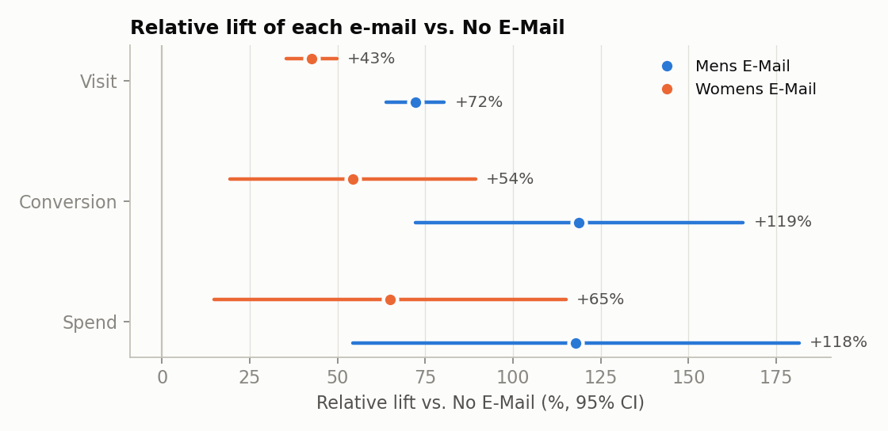

# Hillstrom E-mail Experiment: A/B Testing, CUPED and Uplift Modeling

A reproducible analysis of a real randomized e-mail experiment (64,000 customers, 3 arms).
It goes past the headline A/B result. It checks that the randomization held, tests whether
variance-reduction methods (CUPED, regression adjustment, CUPAC) actually help on this data,
checks that the tests are calibrated with 1,000 A/A simulations, and asks whether an uplift model
can target the campaign better than a one-line business rule.

**For the PM-facing conclusion, read the one-pager: [`reports/pm_onepager.md`](reports/pm_onepager.md).**

Every number below is copied from `results/metrics.json`, which `python run_all.py` regenerates
(fixed seeds, deterministic models, about 4 minutes on a laptop).

---

## 1. Problem

An online retailer e-mailed its customers in one of three ways, chosen at random:
a **Mens merchandise e-mail**, a **Womens merchandise e-mail**, or **no e-mail** (control).
The business questions are:

1. Does each e-mail raise site visits, conversions and spend over the next two weeks, and by how much?
2. Which e-mail is better?
3. Can we measure the effect more precisely with pre-period data (CUPED and variants)?
4. Should everyone get an e-mail, or can we target the customers who actually respond (uplift)?

## 2. Data

[Kevin Hillstrom's MineThatData E-Mail Analytics Challenge (2008)](https://blog.minethatdata.com/2008/03/minethatdata-e-mail-analytics-and-data.html).
`data/download.py` fetches the CSV and verifies its SHA-256. The raw file is not committed.

| | |
|---|---|
| Unit | Customer who bought in the last 12 months |
| Size | 64,000 rows: Mens 21,307 / Womens 21,387 / No E-Mail 21,306 |
| Pre-period covariates | `recency` (months since last purchase), `history` (past-year $ spend), `mens`/`womens` (bought that category before), `newbie` (new in the last 12 months), `zip_code`, `channel` |
| Outcomes (2-week window) | `visit` (0/1), `conversion` (0/1), `spend` ($, 0 for non-buyers) |

Outcome distributions matter for the methods. Only 0.9% of customers spend anything, so `spend` is
zero-inflated and heavy-tailed (max $499).

## 3. Methods

| Step | Method | Why |
|---|---|---|
| Randomization check | Chi-square sample-ratio-mismatch (SRM) test; standardized mean differences (SMD) of 9 pre-period covariates | A broken split invalidates everything downstream |
| A/B inference | Difference in means with Welch/normal CIs; relative lift with a delta-method CI; **Holm** correction across the 6 arm × metric tests | n ≈ 21k per arm makes the normal approximation fine; the delta method handles the random denominator in a relative lift |
| Robustness for spend | Percentile bootstrap (2,000 resamples) | Checks the normal CI on a zero-inflated metric |
| Variance reduction | (a) **CUPED** with past-year spend as covariate; (b) **regression adjustment** (Lin 2013: OLS with centered covariates and treatment interactions, HC2 SEs) on all 9 covariates; (c) **CUPAC**: CUPED using a 5-fold cross-fitted gradient-boosting prediction of the outcome | Same estimand, lower variance if the pre-period data predicts the outcome |
| Calibration | **1,000 A/A tests**: split the control group at random and count false positives at α = 0.05 | Shows the tests (including the adjusted ones) reject about 5% of the time under the null |
| Power | MDE at 80% power, α = 0.05, n = 21,306 per arm | What effect size this design could reliably detect |
| Heterogeneity | Visit uplift by past-purchase type, with a joint Wald test of treatment × subgroup interactions | Interpretable segments, defined before any ML modeling |
| Uplift models | S-, T- (logistic and GBM), X-learner, class-transformation; **5-fold cross-fitting**; Qini coefficient; 200-draw permutation null; compared against a **one-line rule** | Out-of-fold scores are honest; a transparent rule is the bar any model must clear |

The Qini coefficient here is the area between the model's Qini curve and the random-targeting line,
divided by total uplift. 0 means no better than random.

## 4. Results

### 4.1 Randomization holds

- SRM: χ² = 0.20, **p = 0.90** (arm sizes match a 1:1:1 design).
- Largest |SMD| across 9 covariates × 2 comparisons: **0.014** (threshold for concern: 0.1).

### 4.2 Both e-mails work; the Mens e-mail works better

| Arm vs. No E-Mail | Visit rate | Conversion rate | Spend per customer |
|---|---|---|---|
| Control level | 10.62% | 0.573% | $0.65 |
| **Mens E-Mail** | **+7.66 pp** [7.00, 8.32]<br>+72% [+64%, +80%] | **+0.68 pp** [0.50, 0.86]<br>+119% [+72%, +166%] | **+$0.77** [0.49, 1.05]<br>+118% [+54%, +181%] |
| **Womens E-Mail** | **+4.52 pp** [3.89, 5.16]<br>+43% [+35%, +50%] | **+0.31 pp** [0.15, 0.47]<br>+54% [+19%, +89%] | **+$0.42** [0.17, 0.68]<br>+65% [+15%, +115%] |

95% CIs in brackets. All six effects remain significant after Holm correction (largest adjusted p = 0.0011).
The bootstrap CIs for spend agree with the normal CIs: Mens [0.48, 1.05], Womens [0.15, 0.69].

Mens vs. Womens head-to-head: visit **+3.14 pp** [2.43, 3.84], conversion **+0.37 pp** [0.17, 0.56],
spend **+$0.35** [0.03, 0.66] (p = 0.030). The spend difference is the least certain of the three.



Among customers who bought, average order value is similar across arms: Mens $113.5 (n = 267),
Womens $121.9 (n = 189), control $114.0 (n = 122). This is descriptive only, because conditioning on
conversion (a post-treatment outcome) breaks randomization. It suggests the spend lift comes from
*more buyers*, not bigger baskets.

### 4.3 Variance reduction: an honest negative result

| Adjustment | Variance reduction (visit) | Variance reduction (conversion) | Variance reduction (spend) |
|---|---|---|---|
| CUPED (past-year spend) | 0.4% | 0.1% | 0.04% |
| Regression adjustment (9 covariates) | **2.9%** | 0.3% | 0.2% |
| CUPAC (cross-fitted GBM) | 2.4% | 0.1% | 0.03% |

Mens arm shown. The Womens arm is nearly identical (see `results/variance_reduction.csv`).

**Before → after:** the standard error of the Mens visit effect goes from 0.00339 to 0.00334 (−1.5%).
That is worth about **3% more sample**, and it moves the visit MDE from 0.84 pp to 0.82 pp.

**Why so small?** CUPED shrinks variance by about ρ², where ρ is the correlation between the
covariate and the outcome. Here corr(past-year spend, 2-week spend) is only **0.021**, so ρ² ≈ 0.04%.
Even a flexible GBM using all pre-period features predicts 2-week visits with only corr ≈ 0.16.
CUPED works well in product experiments where the *same metric* is observed before the test
(for example, last month's sessions predicting this month's sessions, often with ρ > 0.5).
This dataset has no pre-period version of the outcomes, so it is the wrong setting for CUPED.
The code is still validated: on synthetic data with ρ = 0.7 it recovers the expected 49% variance
reduction (`tests/test_stats.py`).


### 4.4 The tests are calibrated (A/A)

Over 1,000 random splits of the control group (true effect = 0), false-positive rates at α = 0.05 were:

| | Unadjusted | CUPED | Regression adj. |
|---|---|---|---|
| Visit | 4.0% | 4.8% | 5.0% |
| Spend | 4.1% | 4.0% | 4.0% |

All sit inside the 95% Monte Carlo band for a true 5% rate, [3.6%, 6.4%].

### 4.5 Power

With 21,306 customers per arm (80% power, α = 0.05), the minimum detectable effects are:
visit **0.84 pp** (8% relative), conversion **0.21 pp** (36% relative), spend **$0.31** (48% relative).
The visit effects are 5–9× the MDE. The conversion and spend effects are only 1.4–3.3× their MDE,
which is why their CIs are wide.

### 4.6 Who responds? One segment explains most of the heterogeneity

Visit uplift by past-purchase type:

| Past purchases | Mens E-Mail | Womens E-Mail |
|---|---|---|
| Mens only | +6.9 pp [6.0, 7.9] | **+1.1 pp** [0.2, 2.0] |
| Womens only | +7.1 pp [6.1, 8.0] | +7.4 pp [6.4, 8.4] |
| Both | +13.4 pp [10.9, 16.0] | +7.1 pp [4.6, 9.6] |

The treatment × segment interaction is significant for both e-mails (Wald p = 9×10⁻⁶ Mens,
p = 7×10⁻²² Womens). The Womens e-mail does almost nothing for customers who only ever bought mens
merchandise. In a direct Mens vs. Womens comparison within each segment, the Mens e-mail wins for
mens-only buyers (+5.8 pp visit) and for customers who bought both (+6.3 pp). For womens-only buyers
the two e-mails are indistinguishable (−0.3 pp [−1.4, 0.7]).

### 4.7 Uplift models: a one-line rule is as good as the best model

Out-of-fold Qini coefficients (visit outcome, 5 folds, mean ± SD across folds):

| Model | Womens E-Mail | Mens E-Mail |
|---|---|---|
| T-learner (logistic) | **0.178 ± 0.049** | 0.014 ± 0.036 |
| S-learner (GBM) | 0.175 ± 0.051 | 0.019 ± 0.026 |
| T-learner (GBM) | 0.148 ± 0.031 | **0.022 ± 0.013** |
| X-learner (GBM) | 0.152 ± 0.037 | 0.016 ± 0.011 |
| Class transformation (GBM) | 0.098 ± 0.048 | −0.002 ± 0.028 |
| **Rule: "bought this category before"** | 0.176 ± 0.055 | 0.024 ± 0.033 |
| Random targeting (permutation 95th percentile) | 0.037 | 0.017 |

- **Womens e-mail:** targeting works. The top 40% by predicted uplift captures **66%** of all
  incremental visits (visit uplift of +7.4 pp in the top 40% vs. +2.6 pp in the other 60%).
  But the rule "send only to past womens buyers" captures the same 66%. The Qini curves of
  the best model and the rule overlap almost everywhere.
- **Mens e-mail:** there is little heterogeneity to exploit. The best model's top 40% captures 44%
  of incremental visits (random = 40%). Its decile predictions are badly calibrated:
  it predicts +17.7 pp for the top decile, while +10.0 pp is observed. It picked the best of five
  models on the same folds, so its permutation p = 0.035 overstates the evidence.


## 5. Recommendation (short version)

1. **Send the Mens e-mail by default.** It beats the Womens e-mail on every metric, and it is never
   significantly worse in any customer segment.
2. **Do not send the Womens e-mail to mens-only buyers** (+1.1 pp visit uplift, the weakest cell in the study).
3. **Ship the rule, not the model.** A transparent segment rule matches the best uplift model.
   It is easier to explain, monitor and maintain.
4. **Next test:** Mens e-mail vs. a Womens e-mail sent only to womens-only buyers, run long enough to
   measure spend (spend MDE is currently 48% relative).

## 6. Limitations

- **Two-week window.** No data on long-run effects, unsubscribes, or e-mail fatigue. A campaign that
  lifts short-term visits could still hurt long-term engagement.
- **No cost or margin data.** The dataset has revenue only. Sending breaks even when
  cost per e-mail < gross margin × incremental spend per e-mail (+$0.77 Mens, 95% CI [0.49, 1.05]).
  The true margin and cost are unknown.
- **Spend is noisy.** Only about 580 buyers across all arms. Spend CIs are wide, and the Mens vs. Womens spend
  gap (p = 0.030) is the least robust finding.
- **Subgroups were chosen after seeing the data description**, though before modeling. The large
  interaction effects are unlikely to be noise (p < 10⁻⁵), but the exact point estimates would shrink
  in a replication.
- **One dataset, 2008.** The customer base, e-mail channel and creative have changed since then.
  The *method* transfers; the numbers do not.
- **CUPED was evaluated where it is expected to be weak.** The small gains here say nothing about
  experiments that have a strong pre-period metric.

## 7. Design decisions & FAQ

- **Why Holm, not Bonferroni or BH?** Holm controls the family-wise error rate like Bonferroni but is
  uniformly more powerful. With only 6 confirmatory tests, FWER control is the right standard.
  BH (FDR) fits many exploratory metrics better.
- **Why Lin's interacted regression instead of plain ANCOVA?** Without interactions, ANCOVA can be less
  precise than the unadjusted estimator when arms differ in size or response slopes. The interacted
  version is never asymptotically worse (Lin, 2013).
- **Why cross-fit CUPAC?** If the prediction model is trained on the same rows it adjusts, overfitting
  leaks outcome noise into the covariate. Out-of-fold predictions keep the covariate a function of
  pre-period data only.
- **Why class transformation underperforms:** it turns uplift into a single noisy classification target
  (Z = TY + (1−T)(1−Y)). With a 10–18% base rate and a 4–8 pp effect, most of the signal in Z is
  baseline visiting, not uplift.
- **Why T-learner (logistic) ties the GBMs for the Womens e-mail:** the heterogeneity is essentially one
  binary feature (`womens`), which a linear model captures exactly.

## Reproduce

```bash
pip install -r requirements.txt
python data/download.py      # fetch + SHA-256 check
python -m pytest -q tests    # 6 tests on synthetic data with known answers
python run_all.py            # writes results/ and figures/ (~4 min)
```

Or run `make all`.

## Repository layout

```
data/download.py        dataset fetch with checksum
src/stats.py            SRM, SMD, diff-in-means, delta-method lift, CUPED, Lin regression, bootstrap, Holm, MDE
src/uplift.py           S/T/X-learners, class transformation, rule baseline, Qini curve & coefficient
src/plots.py            figures
run_all.py              end-to-end pipeline
tests/test_stats.py     synthetic-data tests for the estimators
results/                metrics.json + CSV tables (every number in this README)
figures/                charts used above
reports/pm_onepager.md  one-page summary for a product manager
```

## References

- Deng, Xu, Kohavi, Walker (2013). *Improving the Sensitivity of Online Controlled Experiments by Utilizing Pre-Experiment Data* (CUPED).
- Lin (2013). *Agnostic notes on regression adjustments to experimental data.* Annals of Applied Statistics.
- Künzel, Sekhon, Bickel, Yu (2019). *Metalearners for estimating heterogeneous treatment effects.* PNAS.
- Jaśkowski & Jaroszewicz (2012). *Uplift modeling for clinical trial data.*
- Radcliffe (2007). *Using control groups to target on predicted lift* (Qini).
